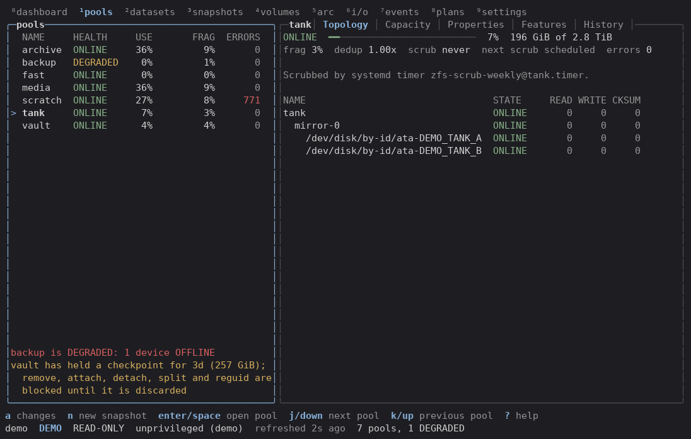

# fstui

fstui is a terminal interface for ZFS on Linux. It shows pools, devices, datasets, snapshots, volumes, the ARC, I/O and kernel events, makes changes to them with `zfs` and `zpool`, each one shown in full and confirmed first, and sends notifications when a pool needs attention.

> [!NOTE]
> Please note that fstui is in early development. There will be heavy iteration up until the 1.0 release while features are steadily rolled out and optimized.

[](https://github.com/nuclear-gumbo/fstui/actions/workflows/ci.yml)
[](https://github.com/nuclear-gumbo/fstui/releases)



fstui starts read-only. Changes need write mode (`W`), show the exact commands and what they destroy before anything runs, are checked against the system again just before they run, and are recorded in an audit log.

## What it shows

- Pools: health, capacity, fragmentation, scrubs, device errors, the device tree, space by dataset, properties with help text, features, history.
- Datasets: the hierarchy, space by reason, properties, snapshots, delegated permissions.
- Snapshots and volumes across all pools; what changed since a snapshot; the size of a `zfs send` before running it.
- The ARC, I/O per pool and device, and kernel events.
- Tune: whether a pool's settings fit how it is used, measured while you watch. Write amplification, record size against request size, where memory would buy speed, what limits the pool, how well data compresses.

## What it changes

- Snapshots: create, hold, release, bookmark, clone, rename, roll back, destroy.
- Filesystems and volumes: create, rename, resize, set and inherit properties, mount, unmount, promote, destroy; encryption keys.
- Pools: create, add devices, checkpoints, scrub, trim, initialize, clear errors, import, export, upgrade.
- Devices: attach, replace, detach, remove, online, offline; RAIDZ expansion.
- The ARC's size limits, and the two module parameters Tune can point to.
- Schedules: scrub and trim per pool, and the notification service, on systemd, OpenRC or cron.

[docs/changes.md](docs/changes.md) lists every change and how it is confirmed.

## Notifications

fstui tells you when a pool needs attention: a pool that is not ONLINE, a device that dropped out, data errors, a pool filling up, slow disks, an overdue scrub, and more. Each alert is turned on per pool and per channel, with its own threshold and message, and you can add your own. Messages go to ntfy, a webhook, Gotify, Pushover, Telegram, Discord, Slack, Matrix or email.

They are sent by `fstui watch`, a service that fstui sets up for you on systemd or OpenRC (or `fstui check` from a timer or cron job), so nothing has to be run by hand. The Config view (`9`) shows whether it runs, and sets it up when it does not. An optional heartbeat URL lets a service such as Healthchecks warn you when the host itself goes down. Setting it up: [docs/notifications.md](docs/notifications.md).

## Other hosts

fstui shows the pools of other machines over SSH, read-only, with your own keys and `~/.ssh/config`: `fstui --host pve1`, or `H` to switch. On a Proxmox VE node it finds the cluster's other nodes, and `fstui watch` can check every host for one set of notifications. Setting it up: [docs/remote.md](docs/remote.md).

## Requirements

- Linux with OpenZFS 2.3 or newer, userland and kernel module. fstui refuses older versions and names the one it found.
- `zfs` and `zpool` in `/usr/sbin`, `/usr/bin`, `/sbin` or `/bin`, owned by root.
- A terminal of at least 80 by 24 cells.

## Install

```sh
v=0.8.6
curl -LO https://github.com/nuclear-gumbo/fstui/releases/download/v$v/fstui-$v-linux-amd64
curl -LO https://github.com/nuclear-gumbo/fstui/releases/download/v$v/SHA256SUMS
sha256sum --check --ignore-missing SHA256SUMS
sudo install -m 0755 fstui-$v-linux-amd64 /usr/local/bin/fstui
```

`go install`, Nix and building from source: [docs/install.md](docs/install.md).

To try fstui without ZFS, the demo container runs it on recorded output:

```sh
podman run -it --rm -e COLORTERM ghcr.io/nuclear-gumbo/fstui-demo
```

## Start

```
fstui                 read-only
sudo fstui --write    start in write mode
fstui --dry-run       record confirmed changes without running them
sudo fstui watch      the notification service: checks every pool every 5 minutes and on kernel events
sudo fstui check      check every pool once and send notifications, for a timer or cron job
```

`?` lists the keys of the current view. `0` to `9` switch views, `a` opens the changes for the selection.

## Documentation

- [docs/install.md](docs/install.md): every way to install, and building without the code that changes storage
- [docs/usage.md](docs/usage.md): the views and what they show
- [docs/keys.md](docs/keys.md): every key
- [docs/changes.md](docs/changes.md): write mode, confirmations, saved plans, the audit log, changes without root
- [docs/notifications.md](docs/notifications.md): getting notified: channels, alerts, the notification service
- [docs/remote.md](docs/remote.md): other hosts over SSH and Proxmox VE clusters
- [docs/configuration.md](docs/configuration.md): every setting, drop-in files, themes, keys, schedules
- [docs/troubleshooting.md](docs/troubleshooting.md): messages and what to do about them
- [docs/codebase.md](docs/codebase.md) and [CONTRIBUTING.md](CONTRIBUTING.md): how the code is put together, and how to change it

## Contributing

[CONTRIBUTING.md](CONTRIBUTING.md). Report security problems privately as described in [SECURITY.md](SECURITY.md).

## License

GPL-3.0-or-later. See [LICENSE](LICENSE). The shipped themes credit their palettes' authors in `internal/theme/themes/`.
